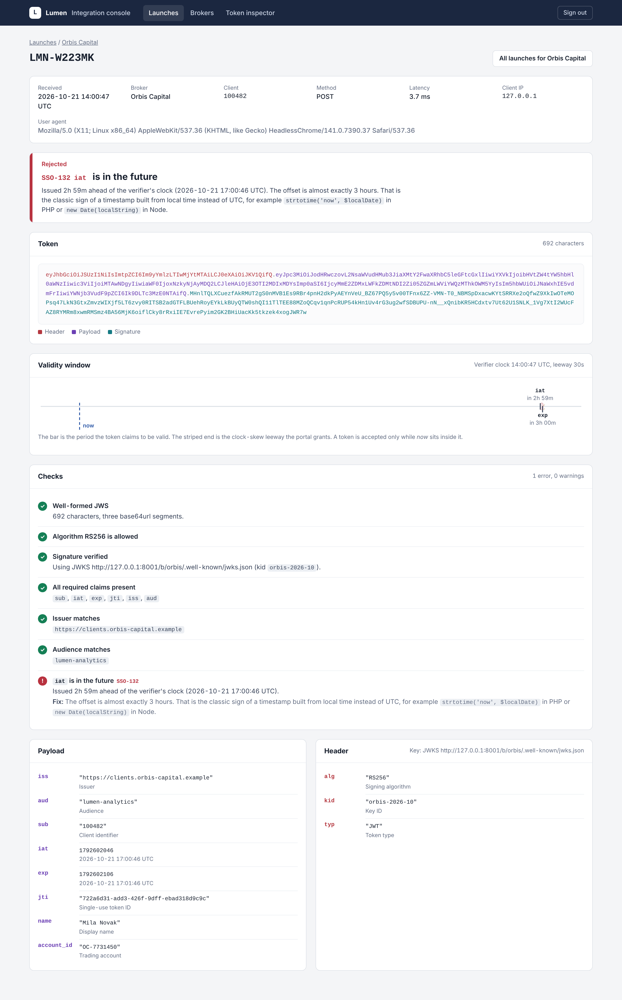
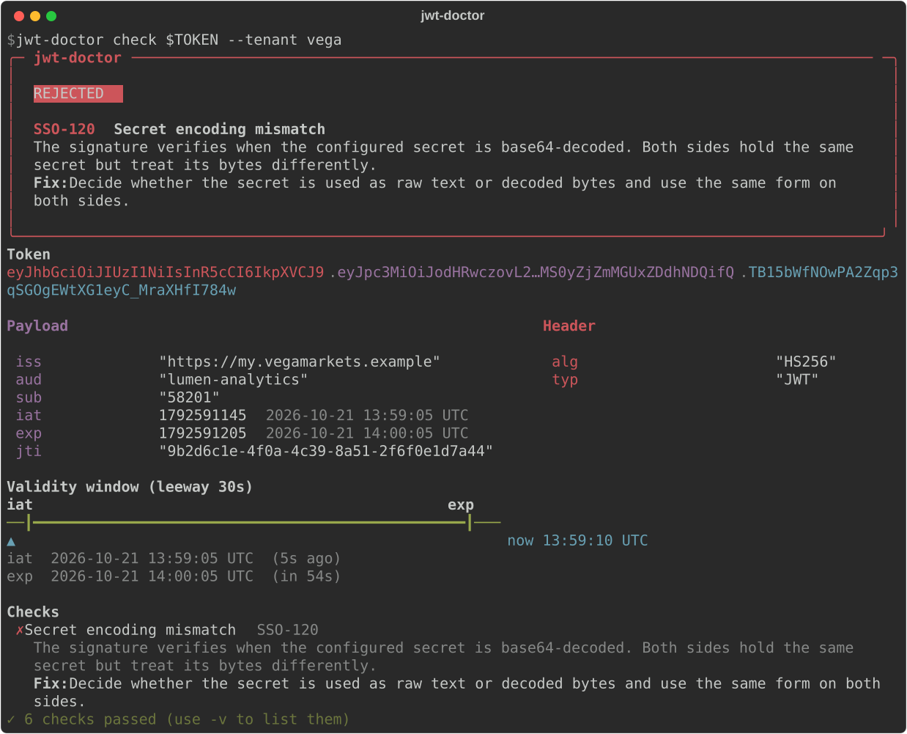
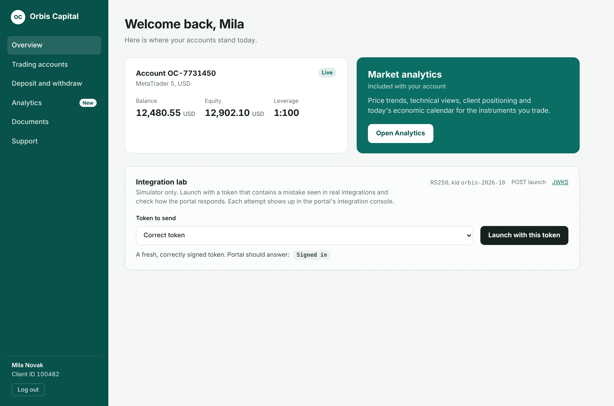
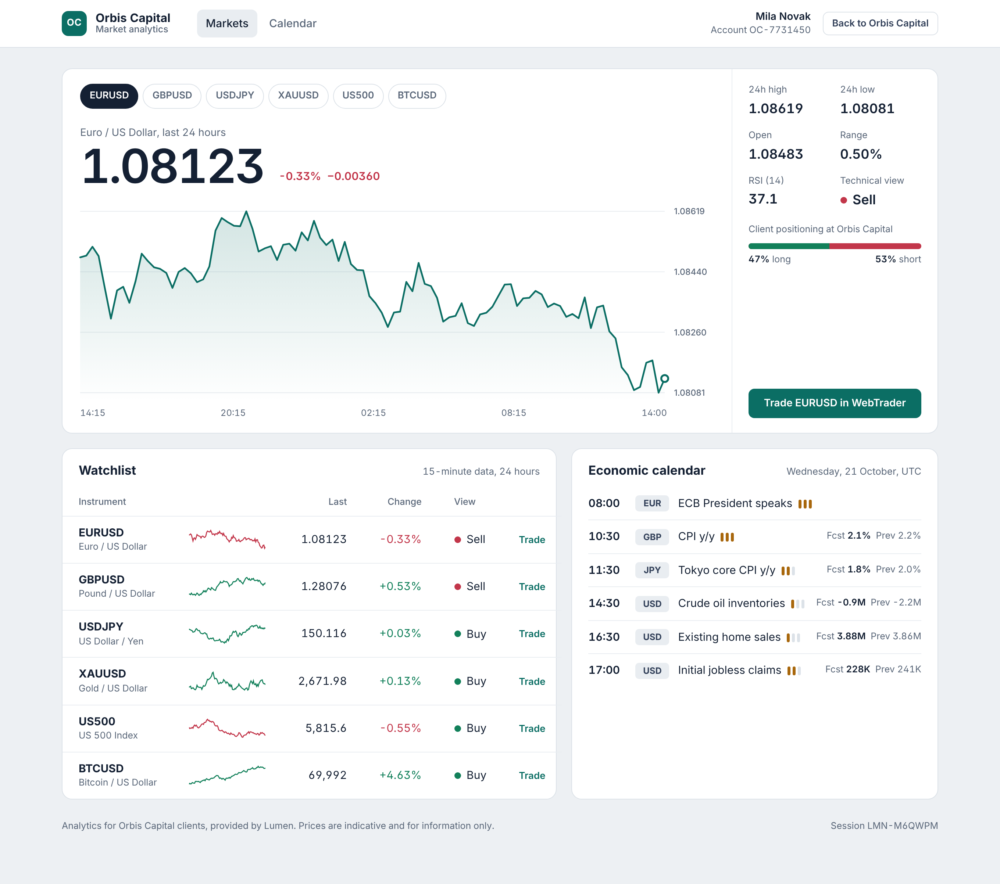
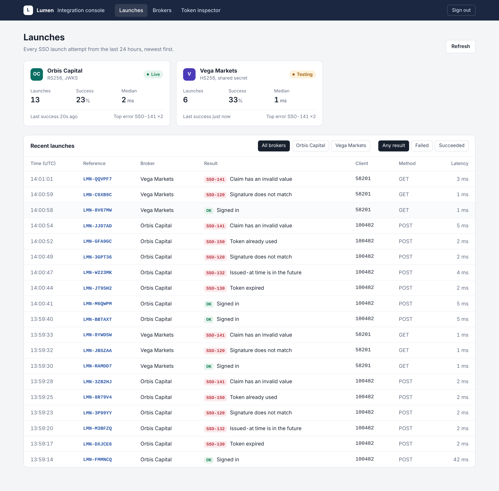
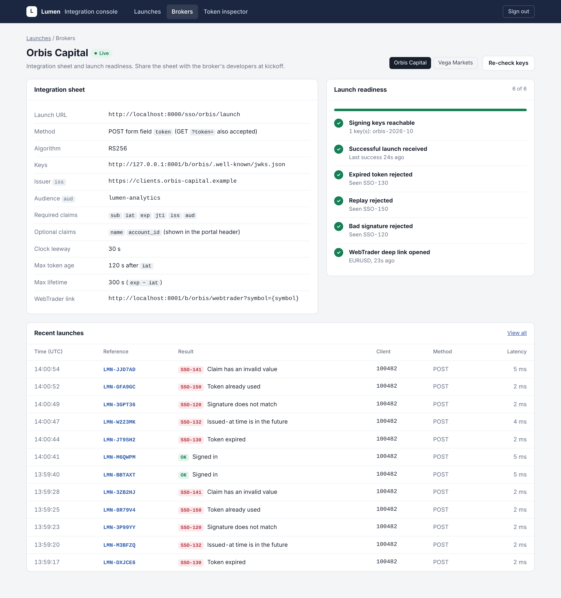
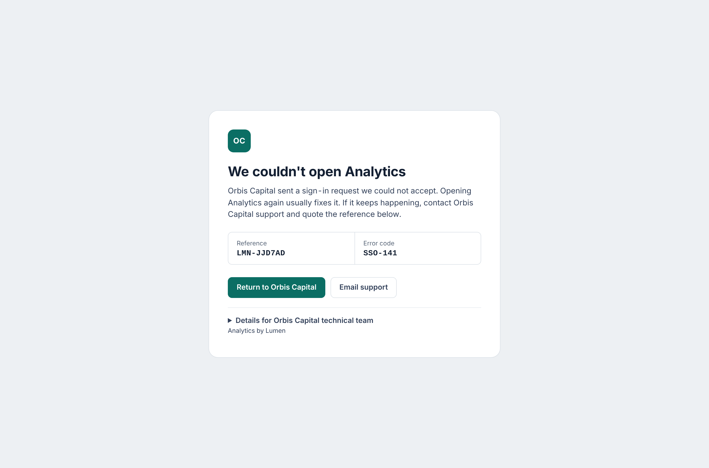
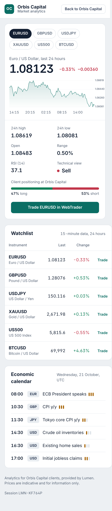

# SSO Integration Kit

Рабочая модель **единого входа (SSO) на JWT между брокером и SaaS-платформой**. Клиент брокера
нажимает «Открыть аналитику» в своём личном кабинете и попадает в аналитический портал уже
авторизованным, в фирменном стиле своего брокера. Вокруг этого сценария собраны инструменты,
которые нужны команде интеграций, чтобы подключать новых брокеров, тестировать подключение и
разбирать ошибки.

Основной фокус проекта не на успешном входе, а на том, что занимает больше всего времени в
реальных интеграциях: **понять, почему вход не прошёл**, и объяснить разработчику партнёра,
что именно исправить.



## Из чего состоит

| Часть | Что делает |
| --- | --- |
| **Аналитический портал** | Принимает токен на `/sso/{broker}/launch`, проверяет его через JWKS брокера или общий секрет, создаёт сессию и показывает дашборд в цветах брокера. При ошибке клиент видит понятную страницу с номером обращения и кодом ошибки. |
| **Консоль интеграций** | Все попытки входа с вердиктом, раскрашенным токеном, шкалой времени `iat`/`exp` относительно часов сервера и конкретной проверкой, которая не прошла. Инспектор токенов, лист интеграции для брокера и чек-лист готовности к запуску, который отмечается сам по мере тестовых входов. |
| **Симулятор брокера** | Два вымышленных брокера: RS256 с JWKS и POST-запуском, HS256 с общим секретом и GET-запуском. Панель *Integration lab* отправляет токены с 17 типичными ошибками из реальных интеграций. |
| **CLI `jwt-doctor`** | Тот же движок проверки в терминале. Вставляешь токен из логов партнёра и получаешь диагноз текстом или JSON, на текущий момент или на момент выпуска токена. |
| **Примеры кода для брокеров** | Генерация токена на PHP (`firebase/php-jwt`), Node.js (`jsonwebtoken`) и Python (`PyJWT`). Каждый пример в CI проверяется по правилам портала. |
| **Документация** | [Гайд для разработчиков брокера](docs/integration-guide.md), [чек-лист запуска](docs/launch-checklist.md), [справочник ошибок](docs/troubleshooting.md), [частые ошибки в коде](examples/COMMON_MISTAKES.md), [архитектура](docs/architecture.md). |

## Быстрый старт

```bash
pip install -e ".[dev]"
ssokit-dev
```

| | |
| --- | --- |
| Симулятор брокера | http://localhost:8001 (демо-логин уже подставлен) |
| Аналитический портал | http://localhost:8000 |
| Консоль интеграций | http://localhost:8000/console, пароль `console` |

Или через Docker:

```bash
cp .env.example .env
echo "VEGA_SSO_SECRET=$(openssl rand -base64 33)" >> .env
docker compose up --build
```

Секретов в репозитории нет: при локальном запуске (`ssokit-dev`) общий секрет HS256 генерируется заново, RSA-ключ брокера создаётся в папке `keys/`, которая исключена из git.

Войди в кабинет *Orbis Capital*, нажми **Open Analytics**, затем выбери сломанный токен в
панели Integration lab и запусти ещё раз. В консоли каждая попытка будет разобрана по шагам.

## Главная фишка: диагноз, а не просто отказ

Обычный `jwt.decode` скажет «Signature verification failed». Портал говорит, в чём причина:



Движок проверки выполняет все проверки, какие можно безопасно выполнить, и объясняет причину
сбоя:

| Что не так с токеном | Что сообщает портал |
| --- | --- |
| HMAC-подпись не сходится, но сходится, если секрет декодировать из base64 | `SSO-120` Secret encoding mismatch: секрет одинаковый, но стороны используют его в разной кодировке |
| `iat` на 2 ч 59 мин в будущем | `SSO-132` и пояснение, что сдвиг на целое число часов означает локальное время вместо UTC |
| `exp` = 1792591205000 | `SSO-141` время в миллисекундах, нужно разделить на 1000 |
| `iss` отличается слэшем на конце | `SSO-143` и пояснение, что отличается только слэш |
| Токен HS256 пришёл брокеру с RS256 | `SSO-110` с пометкой, что это схема атаки algorithm confusion |
| `sub: 100482` числом | `SSO-141` `sub` должен быть строкой, с примером приведения типа для PHP и JS |
| `iat` 10 минут назад, `exp` ещё действует | `SSO-133` токен закэширован в странице, а не создан по клику |
| Один и тот же `jti` дважды | `SSO-150` повторное использование токена |
| `Bearer eyJ...`, кавычки, двойное URL-кодирование | Конкретная ошибка передачи, а не абстрактное «malformed» |

Все коды ошибок живут в одном каталоге ([`errors.py`](src/ssokit/core/errors.py)). Из него
читают страница ошибки, консоль, CLI и [troubleshooting.md](docs/troubleshooting.md), а CI
падает, если документация разошлась с кодом.

## Экраны

| | |
| --- | --- |
|  |  |
| Кабинет брокера с панелью Integration lab | Дашборд портала в стиле брокера |
|  |  |
| Все попытки входа по брокерам с фильтрами | Лист интеграции и готовность к запуску |
|  |  |
| Что видит клиент, если вход не прошёл | Дашборд на телефоне |

## jwt-doctor

```bash
jwt-doctor check "$TOKEN"                                 # декодировать и проверить без ключа
jwt-doctor check - --secret-env VEGA_SSO_SECRET < token   # HS256, секрет из переменной окружения
jwt-doctor check "$TOKEN" --jwks https://broker/.well-known/jwks.json --aud lumen-analytics
jwt-doctor check "$TOKEN" --tenant orbis                  # настройки портала для конкретного брокера
jwt-doctor check "$TOKEN" --tenant orbis --at 1792591172  # на момент, когда токен попал в логи
jwt-doctor check "$TOKEN" --json                          # для скриптов и тикетов
jwt-doctor explain SSO-132                                # что значит код со страницы ошибки
jwt-doctor codes
```

Код выхода `0`, если портал принял бы токен, `1`, если нет, и `2` при ошибке в аргументах.
При передаче секрета через `--secret` выводится предупреждение, потому что он попадает в
историю shell.

## Решения по безопасности

* Алгоритм закреплён за каждым брокером, `alg` из токена сам по себе не принимается на веру.
  `none` и HMAC с публичным ключом отклоняются с понятным объяснением.
* Ключи берутся только из конфигурации. Заголовки `jwk`, `jku` и `x5u` игнорируются и
  помечаются как риск.
* JWKS кэшируется на 5 минут и перезапрашивается при незнакомом `kid`, поэтому ротация ключей
  проходит без созвонов. Перезапросы ограничены по частоте, чтобы поток плохих токенов не
  нагружал сервер брокера.
* Токены одноразовые (`jti`), короткоживущие (`max_age`, `max_lifetime`) и проверяются с явным
  допуском на рассинхрон часов.
* По умолчанию запуск через POST, чтобы токен не попадал в URL. На страницах входа и консоли
  выставлены `Referrer-Policy: no-referrer` и `Cache-Control: no-store`, каждый вход начинает
  новую сессию.
* Секреты читаются из переменных окружения, в конфиге хранится только имя переменной.

Что нужно изменить для продакшена (общее хранилище для защиты от повторов, постоянный лог
входов, SSO для консоли) описано в [architecture.md](docs/architecture.md).

## Структура проекта

```
src/ssokit/
  core/        errors.py (каталог ошибок), inspect.py (движок проверки),
               keys.py (JWKS, PEM, секрет), validator.py (строгая проверка и защита от повторов),
               tenants.py (конфигурация брокеров)
  portal/      FastAPI: вход, дашборд, консоль интеграций
  broker/      FastAPI: симулятор брокера и сценарии с ошибками
  doctor/      CLI jwt-doctor (Typer + Rich)
config/        tenants.toml (сторона портала), brokers.toml (сторона брокера)
examples/      генерация токена на PHP, Node и Python, COMMON_MISTAKES.md
docs/          гайд интеграции, чек-лист запуска, справочник ошибок, архитектура
scripts/       генерация справочника ошибок и скриншотов
tests/         юнит-тесты и все сценарии брокера от начала до конца
```

## Разработка

```bash
make test         # 102 теста, включая все 33 сценария брокера end-to-end
make lint         # ruff и проверка актуальности справочника ошибок
make docs         # пересобрать docs/troubleshooting.md из каталога ошибок
make screenshots  # обновить скриншоты (нужен запущенный make dev и Playwright)
```

Скриншот CLI для README: `python scripts/cli_screenshot.py docs/screenshots`.

Примеры кода для брокеров запускаются так:

```bash
LUMEN_SSO_SECRET=... php examples/php/launch.php 58201
LUMEN_SSO_SECRET=... node examples/node/lumen-sso.js 58201
LUMEN_SSO_SECRET=... python examples/python/lumen_sso.py 58201
LUMEN_PRIVATE_KEY=keys/orbis-2026-10.pem LUMEN_KID=orbis-2026-10 node examples/node/lumen-sso.js 100482
```

CI прогоняет тесты на Python 3.11, 3.12 и 3.13, проверяет примеры на PHP, Node и Python через
`jwt-doctor` и поднимает Docker-окружение.

Orbis Capital, Vega Markets и Lumen Analytics вымышлены. Рыночные данные на дашборде
синтетические.

## Лицензия

MIT
