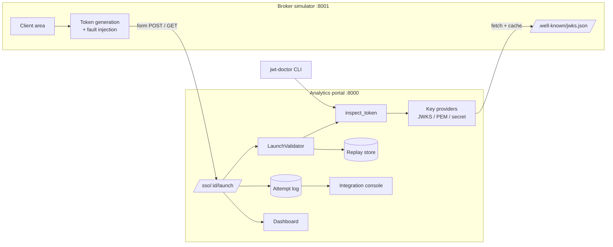

# Architecture

## One inspection engine, three surfaces

`ssokit.core.inspect.inspect_token` runs every check that can safely run and returns a
`Report` with findings in dependency order: structure, header, key, signature, claims, time.
It is used by:

* **the launch endpoint**, in strict mode, where the first error decides the error code;
* **the console's token inspector**, which shows every finding at once;
* **`jwt-doctor`**, the same report rendered in a terminal or as JSON.

This guarantees that what a support engineer sees in the console or the CLI is exactly what
the portal decided. There is no second implementation to drift.

The engine explains failures, not just reports them: an HMAC mismatch is retried with common
encodings of the secret (base64-decoded, trailing newline, hex) to say *which* mistake was
made; an `iat` that is a whole number of hours in the future is reported as a timezone bug;
an `exp` above 1011 as milliseconds.

## Error codes

`ssokit.core.errors.ErrorCode` is the catalog. Each entry has a code, title, cause, fix and
HTTP status. The error page, the console, the CLI and `docs/troubleshooting.md` all read from
it; CI fails if the generated doc is out of date.

## Keys

* `JWKSKeyProvider` caches keys for 5 minutes, refetches once on an unknown `kid` (so key
  rotation needs no coordination) and rate-limits refetches to protect the broker.
* Algorithms are pinned per tenant; `alg` from the token is never trusted alone. Keys or key
  URLs inside the token (`jwk`, `jku`, `x5u`) are ignored and flagged.

## What changes for production

| Concern | This repo | Production |
| --- | --- | --- |
| Replay store | In-memory | Redis `SET key 1 NX EXAT <exp>` shared by all instances |
| Attempt log | In-memory ring buffer | Database table or log pipeline, 30-day retention |
| Console auth | Single password | Company SSO, per-user audit trail |
| Secrets | Environment variables | Secret manager, per-environment |
| Cookies | `SSOKIT_SECURE_COOKIES=1` | Always secure, behind TLS |
| Tenant config | TOML file | Admin UI or config service, with change history |
