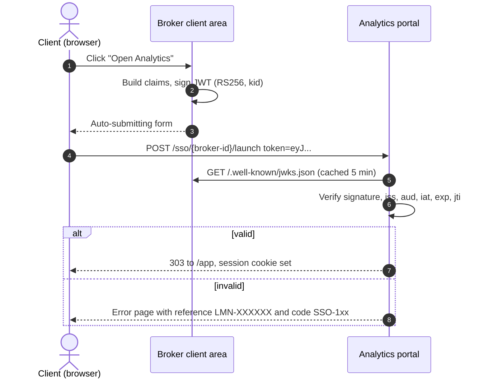

# Integration guide for broker developers

This is the document you send a broker's development team at the kickoff call. It describes
everything they need to build on their side, and nothing they do not.

## How the launch works

Your client is already signed in to your client area. When they click **Open Analytics**,
your backend creates a short-lived signed token that says *who* the client is, and the
browser carries it to the portal. The portal checks the signature with your public key,
starts a session and shows the dashboard with your branding. There is no second password
and no user database to sync.

## What we agree on at kickoff

| Item | Example | Notes |
| --- | --- | --- |
| Broker ID | `orbis` | Part of the launch URL |
| Launch URL | `https://portal.example/sso/orbis/launch` | Separate staging and production URLs |
| Algorithm | `RS256` | `HS256` is supported when a key pair is not possible |
| JWKS URL | `https://clients.orbis.example/.well-known/jwks.json` | RS256 only, must be reachable from the internet |
| Shared secret | exchanged out of band | HS256 only, 32+ random bytes, never by email |
| `iss` | `https://clients.orbis.example` | Compared as an exact string |
| `aud` | `lumen-analytics` | Same for every broker |

## Token contents

| Claim | Required | Type | Rule |
| --- | --- | --- | --- |
| `iss` | yes | string | Exactly the agreed issuer |
| `aud` | yes | string or array | Contains the agreed audience |
| `sub` | yes | **string** | Your internal client ID. Not the email, not a number |
| `iat` | yes | integer | Current UNIX time **in seconds, UTC** |
| `exp` | yes | integer | `iat` + 60. At most 300 seconds after `iat` |
| `jti` | yes | string | Random UUID v4, new for every launch |
| `name` | no | string | Shown in the portal header |
| `account_id` | no | string | Shown in the portal header |

Header: `alg` as agreed, and for RS256 a `kid` matching a key in your JWKS.

The portal allows 30 seconds of clock difference, accepts a token at most 120 seconds after
`iat`, and accepts every `jti` once.

## Sending the token

**Recommended: POST.** Render a small page that submits a form to the launch URL with the
token in a hidden field named `token`. The token never appears in a URL, so it does not end
up in browser history, proxy logs or `Referer` headers.

**Supported: GET.** Redirect to `<launch URL>?token=<jwt>`. Simpler, but the token is visible
in logs. If you use GET, keep `exp` at 60 seconds.

Optional field `symbol` (for example `XAUUSD`) opens the dashboard on that instrument.

Ready-to-use code, tested against the portal's rules:

* PHP (`firebase/php-jwt`): [`examples/php/LumenSso.php`](../examples/php/LumenSso.php)
* Node.js (`jsonwebtoken`): [`examples/node/lumen-sso.js`](../examples/node/lumen-sso.js)
* Python (`PyJWT`): [`examples/python/lumen_sso.py`](../examples/python/lumen_sso.py)

## Keys

**RS256 (recommended).** Generate a 2048-bit RSA key pair, keep the private key in your
secret manager, publish the public key as a JWKS. To rotate: publish the new key next to the
old one, wait 10 minutes, start signing with the new `kid`, remove the old key a day later.
The portal refetches the JWKS when it sees an unknown `kid`, so rotation needs no call.

**HS256.** One shared secret per environment, at least 32 random bytes
(`openssl rand -base64 48`). Agree on whether the secret is used as the literal string or
base64-decoded bytes. This is the most common cause of `SSO-120`.

## Testing before launch

1. Launch with a test client in staging. Check your logo and colours.
2. Send an expired token on purpose and confirm the error page links back to your site.
3. Press the browser's back button after a launch and resubmit: you should see `SSO-150`.
4. Open an instrument in WebTrader from the dashboard and confirm the deep link lands on the
   right symbol in your terminal.

The integration team tracks these on the broker's page in the console. See
[launch-checklist.md](launch-checklist.md).

## When something fails

The error page shows a reference like `LMN-7F3K2Q` and a code like `SSO-132`. Send us the
reference; the code alone usually tells you what to fix. Every code is explained in
[troubleshooting.md](troubleshooting.md), and `jwt-doctor explain SSO-132` prints the same
explanation in a terminal.
